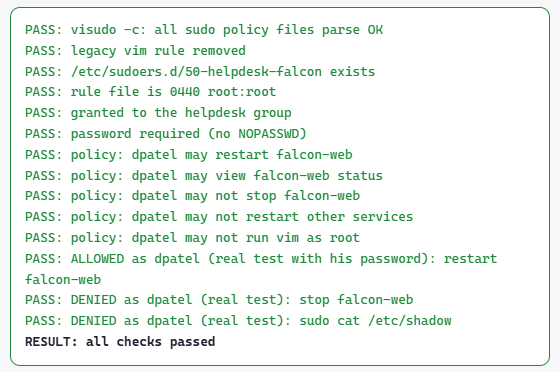

# Linux Contractor Access Lifecycle

> Onboard a contractor on Linux with exactly the access the ticket approves, fix a login that breaks, revoke everything on the last day, and hand an auditor the evidence. Every step is proven by real tests run **as the contractor**: what is allowed, and what is denied.



*Replace with a screenshot of your own capstone check (`lab check m09-capstone`).*

## The problem

Contractors are the riskiest identities in most companies. They get access in a hurry, they often get more than they need, and when the contract ends nobody remembers to take it all back. The account, the SSH key, the sudo rule and the cron job can all outlive the person.

## The scenario (fictional company: Northwind Labs)

| Ticket | What was asked | What I did |
| --- | --- | --- |
| **CAP-9001** Onboard | Jordan Lee (`jlee`), contractor on Project Falcon until 2027-03-31: SSH key login only, write to the Falcon share, restart the Falcon web service, nothing else | Created the account with an expiry date, private home, only `proj-falcon` and `ssh-users`, a locked password (key-only), the approved public key, and **one** sudo rule for one command |
| **CAP-9002** Troubleshoot | "Jordan can't log in" | Found the root cause from the logs, fixed it, re-ran every test |
| **CAP-9003** Revoke | Contract ended | Locked and expired the account, removed the shell, groups, sudo rule, SSH key, processes and cron jobs, archived the home folder. **Kept the account** for the legal hold. |
| **CAP-9004** Evidence | Audit wants proof | Notes with the root cause, plus a generated test report re-checked at report time |

## Least privilege, as configuration

```
# /etc/sudoers.d/70-cap9001-jlee   (mode 0440, checked with visudo -cf before install)
jlee ALL=(root) NOPASSWD: /usr/bin/systemctl restart falcon-web.service
```

Why each part is there: see [`config/70-cap9001-jlee.sudoers`](config/70-cap9001-jlee.sudoers).

## Results: allowed and denied, tested as the contractor

From the real test report ([`evidence/CAP-9001-test-report.txt`](evidence/CAP-9001-test-report.txt)):

| After onboarding | Result |
| --- | --- |
| SSH login with Jordan's approved key | ✅ ALLOWED |
| Create a file in `/srv/projects/falcon` | ✅ ALLOWED |
| `sudo -n systemctl restart falcon-web.service` | ✅ ALLOWED |
| Read `/srv/finance/budget-2027.csv` | ⛔ DENIED |
| List `/srv/hr` | ⛔ DENIED |
| `sudo systemctl stop falcon-web.service` | ⛔ DENIED |
| `sudo cat /etc/shadow` | ⛔ DENIED |
| Password login | ⛔ DENIED |

| After revocation | Result |
| --- | --- |
| SSH login with Jordan's key | ⛔ DENIED |
| Any sudo | ⛔ DENIED |
| Write to `/srv/projects/falcon` | ⛔ DENIED |
| Account kept, locked, expired, no shell, no groups, home archived | ✅ verified |

## CAP-9002 root cause

> Fill this in with **your** run: the lab breaks the login in a different way for every learner.

- **Symptom:** `Permission denied (publickey)` when Jordan tried to log in.
- **Evidence:** [what the log said, e.g. `sudo journalctl -u ssh -n 20`]
- **Root cause:** [e.g. the key in `~jlee/.ssh/authorized_keys` was not the key in the ticket: fingerprint `ssh-keygen -lf` did not match]
- **Fix:** [what you changed]
- **Proof:** every allowed and denied test above re-ran and passed.

The four things worth checking for a key login that "suddenly" fails: the key itself (fingerprint), permissions on `~/.ssh` and `authorized_keys`, account expiry (`chage -l`), and the login shell.

## Evidence (labelled)

| Artifact | Type |
| --- | --- |
| [`evidence/CAP-9001-test-report.txt`](evidence/CAP-9001-test-report.txt) | real, generated by the lab's checks |
| [`evidence/notes.md`](evidence/notes.md) | written by me |
| [`config/70-cap9001-jlee.sudoers`](config/70-cap9001-jlee.sudoers) | real config, with notes |
| [`runbook.md`](runbook.md) | the commands, step by step |
| `screenshots/` | real, redacted |

## What I learned

- Grant the command, not the shell: one sudo line for one action, nothing that opens an editor or a shell.
- Lock first, delete after the audit. The account stays so the logs still mean something.
- Revocation is a list, not a command: key, sudo, groups, shell, processes, cron, password, expiry.
- [Your own lesson from CAP-9002]

---
Built in the *Linux IAM Lab From Zero To Hero* on a dedicated Ubuntu Server 24.04 VM. All people, hosts and data are fictional.
