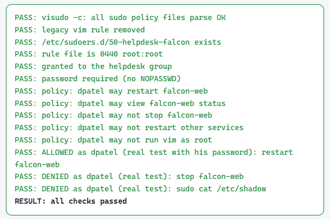

# Linux SSH and sudo hardening

> Least privilege for the two ways people get power on a Linux server: **who can log in over SSH**, and **what they can run as root**. Small drop-in files, a note on every line, and tests that prove both the allowed and the denied side.



## Files

| File | Ticket | What it does |
| --- | --- | --- |
| [`sudoers.d/50-helpdesk-falcon`](sudoers.d/50-helpdesk-falcon) | OPS-5002 | Helpdesk may restart one service, with their own password, and nothing else (`noexec`). Replaces a rule that allowed `vim` as root. |
| [`sshd_config.d/10-hardening.conf`](sshd_config.d/10-hardening.conf) | SEC-6003 | No root login, 3 tries, 30-second login window, no X11, only the `ssh-users` group |
| [`sshd_config.d/20-revoked-keys.conf`](sshd_config.d/20-revoked-keys.conf) | SEC-6004 | A stolen laptop's key is refused for every account, even if someone adds it back |

Every line has a comment saying **why** it is there.

## How to apply (safely)

```bash
# sudo: never edit live; validate a copy first
sudo visudo -cf 50-helpdesk-falcon && \
  sudo install -m 440 -o root -g root 50-helpdesk-falcon /etc/sudoers.d/

# SSH: keep a second session open, validate, then reload (not restart)
sudo install -m 644 10-hardening.conf 20-revoked-keys.conf /etc/ssh/sshd_config.d/
sudo sshd -t && sudo systemctl reload ssh
sudo sshd -T | grep -Ei 'permitrootlogin|maxauthtries|allowgroups|revokedkeys'   # effective settings
```

## Tested: allowed and denied

Run as the affected users (real logins and real `sudo` with their own password) on the lab VM:

| Test | Result |
| --- | --- |
| dpatel (helpdesk): `sudo systemctl restart falcon-web.service` | ✅ ALLOWED (service PID changed) |
| dpatel: `sudo systemctl stop falcon-web.service` | ⛔ DENIED |
| dpatel: `sudo cat /etc/shadow` | ⛔ DENIED |
| dpatel: `sudo systemctl status falcon-web.service` | ⛔ DENIED (not needed: `systemctl status` works without sudo) |
| dpatel: `vim` as root | ⛔ not allowed by the policy (`sudo -l -U dpatel`; legacy rule removed) |
| aokafor (in `ssh-users`): SSH key login | ✅ ALLOWED |
| jkim (not in `ssh-users`): SSH key login | ⛔ DENIED by `AllowGroups` |
| enovak: key from the new tablet | ✅ ALLOWED |
| enovak: key from the stolen laptop, even after re-adding it to `authorized_keys` | ⛔ DENIED by `RevokedKeys` |

## Why these choices

- **Drop-in files** (`sudoers.d`, `sshd_config.d`): small, reviewable, one ticket per file, and package updates never overwrite them.
- **Validate before you apply**: one typo in sudoers can lock every admin out; `sshd -t` catches a bad SSH config before it takes the server off the network.
- **Group, not person** for permanent roles (`%helpdesk`, `ssh-users`): joiners and leavers are handled by membership, and reviews look at one group.
- **Never an editor, pager or shell in a sudo rule**: `vim`, `less` and `bash` all let you run anything as root. That includes commands that *open* a pager: `systemctl status` as root can drop into `less`, so it stays out of the rule (it needs no sudo anyway).

## What I learned

- [Your lesson, e.g. `sshd -T` shows the settings that are really in effect, which isn't always what the file says]
- [What you would do differently on a fleet of servers]

---
Built in the *Linux IAM Lab From Zero To Hero* on Ubuntu Server 24.04. All people and hosts are fictional.
